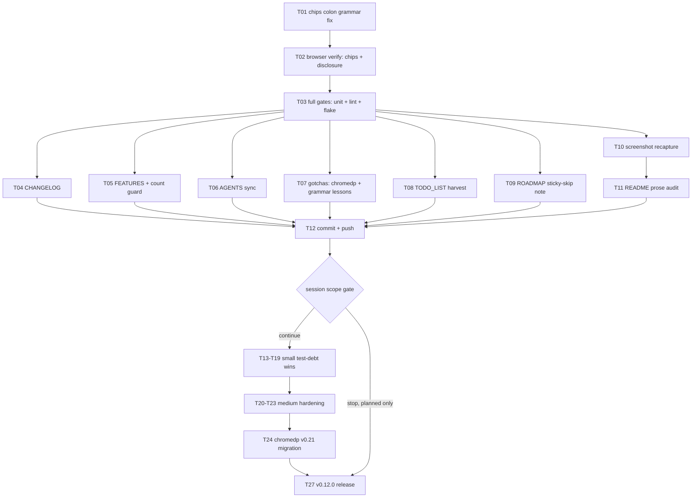

# UI/UX Batch Closeout + Carried Queue — Pareto Execution Plan

**Date:** 2026-10-25 07:52 CET
**Trigger:** "How can we improve the UI/UX" session → 4 shipped improvements + 1 blocked feature → this plan unblocks, verifies, documents, and ranks the full remaining queue.
**Inputs:** `TODO_LIST.md` (2026-10-09 + 2026-10-13 harvest tables), `ROADMAP.md` theme 6, `docs/status/2026-10-25_07-39_ui-ux-batch-chips-blocked.md` (this session's prior stop-report), live tree at `e77809f` (daemon-clean).

## Session context (what this plan starts from)

Shipped this session (unit-verified, goldens pinned): touch/keyboard evidence
tooltips + unproven-green dashed marker (P1), severity-toned group count chips
(P2), EmptyState filter hint (P3), latency budget tooltip (P4), inverted
filter-hint polarity bug fix, chromedp v0.16.0 pin restoration (daemon bump
93d13fd had broken the whole test build).

Blocked: status filter chips — `TestBrowser_StatusFilterChips` red.
**RESOLVED DURING PLANNING (empirically, static module-loaded probe page):**
the vendored Datastar v1.0.3 bundle requires the colon grammar
`data-on:click` (hyphen form is silently ignored; the name parser splits
plugin keys on `:` only); signal assignment `$signal = value` compiles to a
valid signals-proxy write and reactive attributes follow. My earlier probe
failures were harness artifacts: the SDK is an ES module — a classic
`<script src>` throws `Unexpected token 'export'` and never runs; the
dashboard serves it correctly, my first probe page 404'd the script.

## Pareto breakdown

- **The 1% that delivers 51%:** change `data-on-click` → `data-on:click` on
  the three chips (one word) and prove it in the real browser test. This
  unblocks the only red test, completes the marquee UI feature of the batch,
  and unlocks every downstream step (docs, screenshots, release).
- **The 4% that delivers 64%:** the fix + the full verification stack (both
  new browser tests, full unit suite, lint, flake check) + the core doc sync
  (CHANGELOG, FEATURES, TODO_LIST, AGENTS).
- **The 20% that delivers 80%:** all of the above + gotchas/ROADMAP entries,
  screenshot recapture, README prose audit, harvest of stale TODO rows, and
  the detailed commit + push.
- **The other 80% (to 100%):** the carried test-debt queue (fuzz/overflow/
  hardening tests), the chromedp v0.21 migration decision, CI canary,
  LOADTEST re-run, consumer sweep, deploy bump, upstream filings, and the
  v0.12.0 release (cadence-gated).

## Execution graph

## Medium plan (30–100 min tasks, sorted by importance/impact/effort/customer-value)

| #   | Task                                                                 | Tier | Impact | Effort | Customer value                                                       |
| --- | -------------------------------------------------------------------- | ---- | ------ | ------ | -------------------------------------------------------------------- |
| T01 | Chips event grammar fix: `data-on:click` ×3 + unit expr updates      | 1%   | CRITICAL (unblocks only red test) | S (30m) | The feature operators actually use: one-click "show me what's broken" |
| T02 | Browser verify: `TestBrowser_StatusFilterChips` + `TestBrowser_EvidenceDisclosureFocus` | 4% | CRITICAL | S (30m) | Proven interaction on the real SDK, not just markup |
| T03 | Full gates: `go test .`, `nix run .#lint`, `nix flake check`         | 4%   | CRITICAL | M (40m) | Nothing ships red                                                    |
| T04 | CHANGELOG `[Unreleased]`: P1–P5 + polarity bug + chromedp pin note   | 4%   | HIGH    | S (30m) | Trust: honest change history                                         |
| T05 | FEATURES.md sync + test-count drift guard numbers                    | 4%   | HIGH    | S (30m) | Honest feature inventory                                             |
| T06 | AGENTS.md: templ-components pin v1.23.0, colon-grammar gotcha, browser-tests-in-unit-run note, evidence/chips bullets | 4% | HIGH | S (40m) | Future sessions stop re-tripping these traps |
| T07 | `docs/gotchas.md`: chromedp daemon-bump incident + ES-module/grammar probe lessons | 20% | HIGH | S (30m) | Fleet-wide incident memory                                           |
| T08 | TODO_LIST harvest: close touch-tooltips/f23/f11 rows, add chromedp-migration row | 20% | HIGH | S (30m) | Living backlog truth                                                  |
| T09 | ROADMAP: sticky-header SKIP rationale (overflow wrapper), theme 6 refresh | 20% | MED  | S (20m) | Decisions recorded, not re-litigated                                 |
| T10 | Screenshot recapture (light/dark/degraded) with new UI               | 20%  | MED     | M (50m, network-gated) | The README is the sales page                                          |
| T11 | README prose audit vs new UI (f9)                                   | 20%  | MED     | M (40m) | Docs match the product                                               |
| T12 | Detailed commit(s) + push                                           | 20%  | HIGH    | S (20m) | Landed, not local                                                    |
| T13 | `resolvePushInterval` table test (3 branches, zero coverage)         | 80%  | MED     | S (20m) | Config precedence pinned                                             |
| T14 | `rateLimiter.Allow` fuzz target + fuzz.yml + AGENTS same-change      | 80%  | MED     | M (50m) | 429 behavior adversarially tested                                    |
| T15 | Evidence `maxEvidenceChecks` overflow test                           | 80%  | MED     | S (20m) | Cap honesty pinned                                                   |
| T16 | Export CSV formula-injection hardening test                         | 80%  | MED     | S (30m) | Spreadsheet safety claim proven                                      |
| T17 | Public-mode differential leakage test (HTML vs JSON)                | 80%  | MED     | M (40m) | Anonymization contract proven end-to-end                             |
| T18 | `statusValue` exhaustive-switch guard test                          | 80%  | MED     | S (15m) | New-status decisions stay explicit                                   |
| T19 | `HealthCheck` `push.interval > 0` dead-condition check              | 80%  | MED     | S (20m) | Dead code removed or pinned                                           |
| T20 | Nightly flake canary CI job (`-race -shuffle=on -count=5`)          | 80%  | MED     | M (30m) | Flakes found nightly, not in release weeks                            |
| T21 | Webhook bounded in-flight test vs slow receiver                     | 80%  | MED     | M (40m) | Bounded-goroutine claim proven                                       |
| T22 | Metrics label-escaping property/fuzz test                          | 80%  | MED     | M (30m) | Hand-rolled escaping adversarially tested                            |
| T23 | `check-ui-pins.sh`: RecommendedCSP↔SDK-version sync check           | 80%  | MED     | M (30m) | CSP policy cannot silently drift                                     |
| T24 | chromedp v0.21 migration (deliberate, ~100 call sites) OR pin-policy decision | 80% | MED | L (100m+) | Test build rides a maintained dep                                    |
| T25 | health-hub `HEALTH_HUB_*` env table tests                           | 80%  | LOW     | M (40m) | Hub knobs pinned                                                     |
| T26 | LOADTEST re-run post-floor + research note                          | 80%  | LOW     | L (60m) | Fresh perf evidence                                                  |
| T27 | Cut v0.12.0 with the UI batch (release checklist; cadence-gated)    | 80%  | HIGH    | M (80m) | Users get the batch                                                  |

**Session execution scope:** T01–T12 (the 20% core). T13+ are planned,
sorted, and stay in TODO_LIST for the next sessions unless time remains.

## Fine plan (≤12 min each, sorted; ALL todos covered)

| #    | Micro-task                                                        | Parent | Est |
| ---- | ----------------------------------------------------------------- | ------ | --- |
| F01  | view.templ: `data-on-click` → `data-on:click` (3 buttons)         | T01    | 2m  |
| F02  | Update `statusChipPressedExpr`/comment grammar refs if any        | T01    | 5m  |
| F03  | `templ generate` + `nix fmt`                                      | T01    | 4m  |
| F04  | Unit tests for chip exprs re-run                                  | T01    | 3m  |
| F05  | Regold if markup changed                                          | T01    | 3m  |
| F06  | Run `TestBrowser_StatusFilterChips`                               | T02    | 8m  |
| F07  | Run `TestBrowser_EvidenceDisclosureFocus`                         | T02    | 6m  |
| F08  | Full browser suite (serialized)                                   | T02    | 12m |
| F09  | Full unit suite `go test .`                                       | T03    | 6m  |
| F10  | `nix run .#lint`                                                  | T03    | 6m  |
| F11  | `nix flake check` (retry-once rule for daemon races)              | T03    | 8m  |
| F12  | CHANGELOG entry draft                                             | T04    | 10m |
| F13  | FEATURES.md: 5 feature bullets + status                           | T05    | 8m  |
| F14  | FEATURES test-count numbers update + guard re-run                 | T05    | 6m  |
| F15  | AGENTS: pin v1.21.0→v1.23.0 correction                            | T06    | 3m  |
| F16  | AGENTS: colon-grammar `data-on:click` gotcha bullet               | T06    | 6m  |
| F17  | AGENTS: `go test .` includes browser tests note                   | T06    | 4m  |
| F18  | AGENTS: evidence disclosure + chips architecture bullets          | T06    | 8m  |
| F19  | gotchas: chromedp daemon-bump incident entry                      | T07    | 8m  |
| F20  | gotchas: ES-module bundle + probe-methodology lesson              | T07    | 6m  |
| F21  | TODO_LIST: close touch-tooltips row (evidence link)               | T08    | 4m  |
| F22  | TODO_LIST: close f23 row (keyboard-links coverage)                | T08    | 3m  |
| F23  | TODO_LIST: f11 row update (measurement done, benchmark open)      | T08    | 3m  |
| F24  | TODO_LIST: add chromedp-v0.21-migration row                       | T08    | 3m  |
| F25  | ROADMAP: sticky-header skip note                                  | T09    | 4m  |
| F26  | ROADMAP theme 6: mark done items                                  | T09    | 4m  |
| F27  | Screenshot: light capture attempt (network check first)           | T10    | 10m |
| F28  | Screenshot: dark + degraded captures                              | T10    | 8m  |
| F29  | README caption/prose diff vs new UI                               | T11    | 10m |
| F30  | README edits (features list, captions)                            | T11    | 10m |
| F31  | `git status` review + intent commit(s) with detailed message      | T12    | 8m  |
| F32  | `git fetch` + push master                                         | T12    | 4m  |
| F33–F39 | T13/T15/T16/T18/T19 as single-test micro-loops (write, run, regold where needed) | T13–T19 | 10m each |
| F40–F45 | T14 fuzz target: write target, seed test, fuzz.yml, AGENTS row, 60s local run, registry diff check | T14 | 12m each |
| F46–F49 | T17: HTML/JSON diff harness, cases (names/errors/uptime), assert, docs | T17 | 12m each |
| F50–F52 | T20: workflow file, trigger config, CI green check                | T20    | 10m each |
| F53–F56 | T21: slow-receiver server, in-flight counter assertion, timeout path, cleanup | T21 | 12m each |
| F57–F59 | T22: property test scaffold, fuzz corpus run, register            | T22    | 12m each |
| F60–F62 | T23: script extension, CSP/SDK version extraction, CI wiring      | T23    | 10m each |
| F63–F68 | T24: inventory call sites, Run→Run[T]/Do migration, allocator rewrite, ListenTarget→event API, suite green, pin decision | T24 | 12m each |
| F69–F72 | T25: env table (addr/remotes/timeout), failure cases, golden docs  | T25    | 10m each |
| F73–F76 | T26: LOADTEST env, run, analyze, research note                     | T26    | 12m each |
| F77–F84 | T27: pre-push-checks, CHANGELOG re-head, version bump, tag, push tag→master, verify-release, SECURITY freshness, GitHub release | T27 | 10m each |

## Errata / corrections to the backlog (verified during planning)

- TODO f23 (keyboard reachability of endpoint links): already covered —
  `TestBrowser_KeyboardLinks` (browser_test.go:1823) asserts all four glyph
  links' accessible names and Enter-activates the jump anchor. Row closes.
- TODO "touch story for evidence tooltips": DONE this session (P1); closes
  with evidence once the disclosure browser test is green (T02/F07).
- TODO f11 (patch payload measurement): spot-measured this session
  (~600 B/pass row + ~470 B strip; 16KB read-window fix in
  aggregate_sse_test); the benchmark-delta half stays open.

## Do-not-verschlimmbessern guardrails

- No revert of the daemon's go.mod churn beyond the verified chromedp/cdproto
  pins (build was provably broken; restoration is proven green).
- The chips fix is a one-word grammar change — no rewrites of the expression
  builders, no new abstractions.
- Docs edits are additive; no restructuring of TODO_LIST beyond the four
  row operations listed.
- Nothing releases (tag) without explicit cadence approval; today ships
  commits + push only.
