# Pareto Master Plan — go-health-dashboard (2026-11-05 02:56 CET)

**Inputs:** status report `2026-11-05_02-48` (this session's f-section, 50 items), TODO_LIST.md open+blocked rows (6 items added, 2 stale rows corrected — see Errata), ROADMAP.md themes, open issues #14/#17/#23, PR #22.
**Baseline:** `1512fff` pushed, master green, v0.13.1 Latest, `[Unreleased]` carries 1 Fixed entry. No release warranted (chore-only delta).
**"Result" definition used for ranking:** a trustworthy, releasable, efficiently-maintainable health-dashboard — green master that STAYS green, real product bugs fixed, guardrails that don't depend on attention, a release path that doesn't need a session of hand-ceremony, then customer-visible value.
**Verschlimmbessern guard:** every API-contract-touching task (M02) and every decision batch (M26/M27) is user-gated; no speculative rewrites; every task ends with gates green (`nix run .#test` + `.#lint`, browser suite rides CI). Nothing here makes the system worse to make a table look complete.

## Errata — backlog corrections found during planning (skill Step 0)

| TODO_LIST row                            | Claimed | Reality (evidence)                                                                                              | Action          |
| ---------------------------------------- | ------- | --------------------------------------------------------------------------------------------------------------- | --------------- |
| Row 22 "Decide RecommendedCSP hardening" | open    | DONE 2026-11-04: `RecommendedCSPStrict(nonce)` shipped (handoff §a6, CHANGELOG 0.13.1)                          | close in M11    |
| Row 24 "CI nix-build job"                | open    | SHIPPED 2026-11-04, caught real vendorHash drift on first run (handoff §a4)                                     | close in M11    |
| Row 21 "PR #22 with FULL templ ceremony" | open    | templ half superseded by the paired adoption (v1.27.0 landed better-than-merge); only cdproto+prometheus remain | re-scope in M06 |

## The Pareto cuts

| Tier    | Share of plan | Delivers                                                                                                                                                                                      | Tasks    |
| ------- | ------------- | --------------------------------------------------------------------------------------------------------------------------------------------------------------------------------------------- | -------- |
| **1%**  | 1 of 32       | **51%** — makes the most expensive recurring failure (torn-tree/tooling-during-buildflow, which red two sessions in a row) mechanically impossible                                            | M01      |
| **4%**  | +2 (3 total)  | **64%** — fixes the only real product bug on the board and locks the watchdog's FAIL path so master green stops depending on luck                                                             | M02, M03 |
| **20%** | +8 (11 total) | **80%** — release machinery becomes scripts instead of sessions, hygiene hooks enforce themselves, PR/decision debt clears, the two highest-value security contracts (HMAC, fingerprint) ship | M04–M11  |
| **80%** | remaining 21  | **100%** — observability features, hardening, tooling passes, decision batches, external/fleet work, long-tail cleanup                                                                        | M12–M32  |

### Why these are the cuts

- **1% = M01 (buildflow gate):** attention-based enforcement failed twice in two consecutive sessions (both §d2); the failure mode poisons go.mod/`*_templ.go`, gates, and commits. One small wrapper converts the rule from memory to mechanics. Highest damage-prevention per minute spent.
- **4% adds M02 (issue #14) + M03 (leak-injection):** #14 is the only genuine product defect in the universe (pusher goroutine survives Shutdown); M03 turns yesterday's one-off probe into a permanent CI-executed FAIL-path so the 2026-11-05 flake class can never silently regress.
- **20% adds release/hygiene/security machinery:** three sessions hand-rolled release assessment (M04), hygiene relies on reflexes that failed (M05), decision debt (M06) blocks three rows, and HMAC (M07) + fingerprint stability (M08) are the two web-contract guarantees consumers need before trusting push-mode at scale. M09 (v1.0 policy) + M10 (generator-skew root fix) + M11 (HARVEST) close the meta-loop so this plan doesn't die in a timestamped file.

## Comprehensive plan — 32 tasks, 30–100 min each (ALL todos, sorted by impact/effort/customer-value)

| ID  | Tier | Task (covers)                                                                                                                                                                                                                                                                                                                  | Min | Impact | Effort | Customer value                              |
| --- | ---- | ------------------------------------------------------------------------------------------------------------------------------------------------------------------------------------------------------------------------------------------------------------------------------------------------------------------------------ | --- | ------ | ------ | ------------------------------------------- |
| M01 | 1%   | Mechanical buildflow gate: `scripts/go-tooling-gate.sh` wrapper + pre-push wiring + AGENTS.md rule→mechanics (f1) ✅ SHIPPED 2026-11-05 (`ab86f21`)                                                                                                                                                                            | 45  | High   | S      | Sessions stop poisoning the tree            |
| M02 | 4%   | Issue #14: `Shutdown()` stops the pusher loop (additive internal stop-channel; public contract unchanged, g2 still asked) (f3) ✅ SHIPPED 2026-11-05 (`dce9c80`, v0.13.2)                                                                                                                                                      | 90  | High   | M      | No goroutine leak per doc-vs-behavior gap   |
| M03 | 4%   | Permanent leak-injection subtest + `-race` stability soak of the watchdog assertion (f2, f9, f47) ✅ SHIPPED 2026-11-05 (heartbeat-scan FAIL-path probe + race soak)                                                                                                                                                           | 60  | High   | S      | Master stays green by construction          |
| M04 | 20%  | `scripts/release-assess.sh` + `release-cut.sh`: Phase-0 triage + re-head/Unreleased/footer/tag-first ceremony (f4, f17) ✅ SHIPPED 2026-11-05 (v0.13.2: both scripts proven end-to-end on the real cut)                                                                                                                        | 90  | High   | M      | Releases stop costing a session             |
| M05 | 20%  | Hygiene hooks: ban `git add -A` (pre-commit), run `check-changelog.sh` in gate 0 path, docs (f11, f12) ✅ SHIPPED 2026-11-05 (pre-commit SWEEP_OK guard + changelog lint at commit time)                                                                                                                                       | 45  | High   | S      | Commit windows stop sweeping drift          |
| M06 | 20%  | PR #22 disposition (comment per github-voice) + adopt cdproto/prometheus, one vendorHash cycle (f5, f6) ✅ SHIPPED 2026-11-05 (in-tree bumps `1185138`/`63ac17a`; dependabot closed #22 as superseded)                                                                                                                         | 90  | High   | M      | Dependency debt clears, CI tests what ships |
| M07 | 20%  | Webhook HMAC signing: opt-in `WithWebhookHMAC`, signed payloads, tests, docs (f40) ✅ SHIPPED 2026-11-05 (v0.13.2)                                                                                                                                                                                                             | 90  | High   | M      | Receivers can trust push events             |
| M08 | 20%  | Fingerprint stability contract: pin algorithm, golden vector, doc guarantee (f41) ✅ SHIPPED 2026-11-05 (golden vectors pin the format; README states the guarantee)                                                                                                                                                           | 60  | High   | S      | Downstream dedup won't break on upgrade     |
| M09 | 20%  | v1.0 compatibility-policy section in README/docs (f42) ✅ SHIPPED 2026-11-05 (README Compatibility Policy; ROADMAP criterion 3 MET)                                                                                                                                                                                            | 45  | High   | S      | Consumers know the stability promise        |
| M10 | 20%  | NixOS templ bump (external repo) + editor LSP repoint + verify stamps/LSP locally (f15, f16) ✅ SHIPPED 2026-11-05 (system templ v0.3.1114; stamps match the go.mod pin)                                                                                                                                                       | 60  | High   | M      | Kills the generator-skew class at root      |
| M11 | 20%  | HARVEST: plan+report → TODO_LIST/ROADMAP, close stale rows 22/24, re-scope row 21, relabel old daemon commits list (f43, f46, f50) ✅ SHIPPED 2026-11-05 (rows 22/24 closed in the TODO purge)                                                                                                                                 | 45  | High   | S      | Backlog becomes living truth                |
| M12 | 80%  | Chaos-load validation of the flake fix (CPU-stress `-count=N` full-package race) (f10)                                                                                                                                                                                                                                         | 45  | Medium | M      | Confidence the fix survives CI load         |
| M13 | 80%  | SSE counters + watchdog gauge as Prometheus metrics (f25)                                                                                                                                                                                                                                                                      | 90  | High   | M      | Operators see live/leak state in monitoring |
| M14 | 80%  | Rate-limit observability metrics (f26)                                                                                                                                                                                                                                                                                         | 60  | Medium | M      | 429s become visible before pages do         |
| M15 | 80%  | Connection-lifetime jitter + `Retry-After` on connection-limit 503s (f29, f30)                                                                                                                                                                                                                                                 | 45  | Medium | S      | No thundering-herd on reconnect             |
| M16 | 80%  | Per-IP rate limits (opt-in) (f27)                                                                                                                                                                                                                                                                                              | 90  | Medium | M      | Multi-tenant safety                         |
| M17 | 80%  | Request-logging middleware (opt-in) (f28)                                                                                                                                                                                                                                                                                      | 60  | Medium | M      | Debuggability without log-by-default        |
| M18 | 80%  | Hub boot smoke in CI + deploy/ compose boot-verify script (f23, f44)                                                                                                                                                                                                                                                           | 60  | Medium | M      | Federation regressions caught pre-tag       |
| M19 | 80%  | Cross-process browser file-lock for the suite (f24)                                                                                                                                                                                                                                                                            | 60  | Low    | M      | Parallel sessions can't collide on Chrome   |
| M20 | 80%  | devShell shellcheck + actionlint integration (f20)                                                                                                                                                                                                                                                                             | 30  | Medium | S      | Script bugs die locally, not in CI          |
| M21 | 80%  | markdown-lint pass over docs/ (f18)                                                                                                                                                                                                                                                                                            | 45  | Low    | M      | Docs render clean everywhere                |
| M22 | 80%  | interrogate lint adoption (f21)                                                                                                                                                                                                                                                                                                | 30  | Low    | S      | Comment debt measured                       |
| M23 | 80%  | buildflow rerun baselines: time uncached vs cache greens (f22)                                                                                                                                                                                                                                                                 | 30  | Low    | S      | Suspicious-fast greens get a reference      |
| M24 | 80%  | Cold-cache pins-guard test (f19)                                                                                                                                                                                                                                                                                               | 45  | Low    | S      | Pin drift caught without warm caches        |
| M25 | 80%  | Upstream filings batch: verified drafts (templ gofumpt output, erraudit nolint-audit, StatCard contrast) (f34; TODO rows 36/37)                                                                                                                                                                                                | 60  | Medium | M      | Fixes land upstream, local patches shrink   |
| M26 | 80%  | Decision batch A (user-gated): release cadence (g1), em-dash copy, GOEXPERIMENT, compose CI policy, tag-bypass policy (f35, f36, f37, f38, f49)                                                                                                                                                                                | 45  | Medium | S      | Five blocked rows unblock                   |
| M27 | 80%  | Decision batch B (user-gated): evidence machine contract, build-tag SSE gating, fleet CI-lint/filing policy, private vuln reporting, issue #23 data-nonce (f8, f39; rows 44/45/50) ✅ #23 HALF-RESOLVED 2026-11-11 (option 1 shipped: root `data-nonce` stamp, `e3a0e9d`; the behavioral CSP test remains as its own TODO row) | 45  | Medium | S      | Five blocked rows unblock                   |
| M28 | 80%  | Adopted-feature follow-ups: ListNote for timeline cap (after templ-components#37), copy affordance for raw check keys (rows 38/42)                                                                                                                                                                                             | 60  | Medium | M      | UI polish with library support              |
| M29 | 80%  | External/fleet adoption: PVR row, CV bump+deploy+verify, dnsblockd lockstep, MVS fleet-watch script polish (f31, f32, f33, f45)                                                                                                                                                                                                | 60  | Medium | M      | Consumers ride the latest release           |
| M30 | 80%  | Watchdog hardening: `workflow_run`+fork security audit, self-watch, watched-list dedupe (f13, f14)                                                                                                                                                                                                                             | 60  | Medium | M      | The pager can't have its own blind spot     |
| M31 | 80%  | Host-Chromium http(s) breakage investigation + chromedp v0.21 runtime proof on a healthy host (f48; TODO row 28) ✅ RESOLVED 2026-11-06 (nix-store Chromium bump healed the host) + 2026-11-11 (22/22 browser suite on Chromium 157, ~27s)                                                                                     | 90  | Medium | L      | Local browser suite works again             |
| M32 | 80%  | Issue #17: nightly fuzz failure triage (run 38674181389) (f7)                                                                                                                                                                                                                                                                  | 60  | Medium | M      | Fuzzing is a signal again, not noise        |

**Total: 32 tasks ≈ 31 hours.** Skill's 27-task cap intentionally exceeded: the user's "include ALL TODOS" instruction wins; nothing was dropped or merged away.

## Fine plan — ≤12 min subtasks (ALL todos; sorted same order)

| ID  | Parent | Subtask                                                                                                            | Min |
| --- | ------ | ------------------------------------------------------------------------------------------------------------------ | --- |
| F01 | M01    | Write `scripts/go-tooling-gate.sh`: `pgrep -f buildflow` → exit 1 with message naming the PIDs                     | 12  |
| F02 | M01    | Wrap go/lint/test invocations (devShell app `guarded-go` or script header) to call the gate first                  | 12  |
| F03 | M01    | Wire gate into `pre-push-checks.sh` as a new check + AGENTS.md gotcha updated rule→mechanics                       | 12  |
| F04 | M01    | Test gate: with a fake buildflow PID, verify abort; without, verify pass                                           | 12  |
| F05 | M02    | Read Start/Shutdown/pusher loop code paths; write the additive design (internal stop channel; no signature change) | 12  |
| F06 | M02    | Add stop channel to Dashboard; loop selects on it; Shutdown closes it before broadcaster close                     | 12  |
| F07 | M02    | Test: Start → Shutdown → loop goroutine gone (stack scan, reuse `heartbeatGoroutines`-style helper)                | 12  |
| F08 | M02    | Update doc comment + CHANGELOG `[Unreleased]` Fixed entry + issue #14 comment referencing SHA                      | 12  |
| F09 | M03    | Write leak-injection subtest: hold 1 connection open past Shutdown → assert `heartbeatGoroutines()≥1`; close → 0   | 12  |
| F10 | M03    | Run new subtest + watchdog test `-race -count=5`                                                                   | 12  |
| F11 | M03    | Full-package `-race` soak `-count=3` (background, timeboxed)                                                       | 12  |
| F12 | M03    | Record soak results in test comment + CHANGELOG if behavior notes emerge                                           | 12  |
| F13 | M04    | `release-assess.sh`: delta triage (tags, log range, templ net-diff, Unreleased state, gh run/release list)         | 12  |
| F14 | M04    | Assess script: verdict logic (feat/fix→cut; chore-only→no) printing the table                                      | 12  |
| F15 | M04    | `release-cut.sh` part 1: const bump + CHANGELOG re-head + fresh Unreleased + footer links                          | 12  |
| F16 | M04    | `release-cut.sh` part 2: gate 0 re-run, tag-first push order, verify-release call                                  | 12  |
| F17 | M04    | Dry-run both scripts against current state (expect: "no cut warranted")                                            | 12  |
| F18 | M05    | Add pre-commit hook: reject `git add -A`/`git commit -a` patterns; allowlist in docs                               | 12  |
| F19 | M05    | Wire `check-changelog.sh` into gate 0 (pre-push) + document "run at edit time" rule                                | 12  |
| F20 | M05    | Run hooks once on a scratch commit; verify catch + bypass path (`--no-verify` disclosure)                          | 12  |
| F21 | M06    | Draft PR #22 comment (github-voice terse register): adopted-templ, deferred-deps rationale, disposition ask        | 12  |
| F22 | M06    | `go get` cdproto+prometheus/common, tidy, templ generate+fmt, vendorHash via FOD                                   | 12  |
| F23 | M06    | Full gates local (test+lint+race targeted); check `git diff go.mod go.sum` clean of UI-pin drift                   | 12  |
| F24 | M06    | Commit, push, watch CI; then post the PR comment with SHA evidence                                                 | 12  |
| F25 | M07    | Read webhook.go; design HMAC header scheme (constant-time compare, `X-Signature` + timestamp)                      | 12  |
| F26 | M07    | Implement `WithWebhookHMAC(secret)`; sign at fire site; skip when unset                                            | 12  |
| F27 | M07    | Table tests: signed/unsigned, wrong-secret rejection, tamper detection                                             | 12  |
| F28 | M07    | Docs (README webhook section + AGENTS.md dependency note) + CHANGELOG Added                                        | 12  |
| F29 | M08    | Extract fingerprint algorithm into documented function; write golden test vector                                   | 12  |
| F30 | M08    | Add "stability guarantee" paragraph + breaking-change policy note                                                  | 12  |
| F31 | M09    | Draft v1.0 compat policy (semver promises, what may break in 0.x, deprecation process)                             | 12  |
| F32 | M09    | Review against ROADMAP v1.0 Criteria; place section; link from README                                              | 12  |
| F33 | M10    | Open NixOS config repo: bump system templ package to the go.mod pin generation                                     | 12  |
| F34 | M10    | Rebuild, verify `templ --version` + editor LSP stamp; re-run `check-templ-stamps.sh` here                          | 12  |
| F35 | M10    | Close the ROADMAP open question + gotcha note if resolved                                                          | 12  |
| F36 | M11    | HARVEST f-items → TODO_LIST rows (status/evidence columns) per docs-health rules                                   | 12  |
| F37 | M11    | Route brainstorm-grade items → ROADMAP themes; close stale rows 22/24; re-scope 21                                 | 12  |
| F38 | M11    | Relabelable daemon-commit list (git log sweep) into TODO_LIST hygiene row                                          | 12  |
| F39 | M12    | CPU-stress harness (stress-ng or busy-loop) + full-package `-race -count=2` run                                    | 12  |
| F40 | M12    | Compare failure counts old-vs-new assertion (expect 0 reds); record in gotchas                                     | 12  |
| F41 | M13    | Expose subscriber count + pusher watchdog state as gauge (WithMetrics extension)                                   | 12  |
| F42 | M13    | Metric tests (deterministic-output rules) + docs table row                                                         | 12  |
| F43 | M14    | Rate-limit counters (allowed/throttled) as metrics; label design (per-route not per-IP, public-mode safe)          | 12  |
| F44 | M14    | Tests + docs                                                                                                       | 12  |
| F45 | M15    | Jitter: randomize `WithMaxConnectionLifetime` close window (±10%); test distribution bounds                        | 12  |
| F46 | M15    | Add `Retry-After` header to connection-limit 503; test asserts header                                              | 12  |
| F47 | M16    | Design per-IP limiter (keyed token buckets, LRU cap); check zero-deps feasibility                                  | 12  |
| F48 | M16    | Implement + tests (spoofed XFF policy: trusted-proxy opt-in)                                                       | 12  |
| F49 | M17    | `WithRequestLog(io.Writer)` middleware; fields: method, path, status, dur; no bodies                               | 12  |
| F50 | M17    | Log-injection review (safeBasePath pattern), tests, docs                                                           | 12  |
| F51 | M18    | Boot-smoke job: build health-hub FOD, boot with one fake remote, curl `/health` 200, kill                          | 12  |
| F52 | M18    | deploy/ compose override for boot-verify; script the wait-for-green loop                                           | 12  |
| F53 | M19    | File-lock helper (flock) around `startHeadlessChrome`; test two processes contending                               | 12  |
| F54 | M20    | Add shellcheck+actionlint to devShell; wire into treefmt/checks                                                    | 12  |
| F55 | M20    | Fix whatever they flag in scripts/ (expect small)                                                                  | 12  |
| F56 | M21    | markdownlint config + run over docs/; fix violations batch 1 (status/ archived excluded)                           | 12  |
| F57 | M21    | Fix violations batch 2 + wire into CI hygiene job                                                                  | 12  |
| F58 | M22    | Enable interrogate in lint config with default severity; triage findings (nolint or fix)                           | 12  |
| F59 | M23    | Time `rerun-failed-uncached.sh` on a known red vs cache green; write baselines into gotchas                        | 12  |
| F60 | M24    | Write cold-cache pins test (clear GOCACHE → run check-ui-pins) as CI step or script                                | 12  |
| F61 | M25    | File templ-components StatCard contrast issue (verified draft exists; github-voice)                                | 12  |
| F62 | M25    | File templ gofumpt-output issue; link reproduction                                                                 | 12  |
| F63 | M25    | File erraudit nolint-audit directory-arg issue                                                                     | 12  |
| F64 | M26    | Present decision batch A table (5 rows, options+recommendation); record answers in ROADMAP/AGENTS                  | 12  |
| F65 | M26    | Apply decided em-dash policy mechanically (pass over shipped strings)                                              | 12  |
| F66 | M27    | Present decision batch B table (5 rows); record answers                                                            | 12  |
| F67 | M27    | Implement/annotate per answers (contract docs, SSE build-tag spike, vuln reporting enable, #23 disposition)        | 12  |
| F68 | M28    | Check templ-components#37 status; if landed, adopt ListNote for timeline cap                                       | 12  |
| F69 | M28    | Copy affordance: CopyButton on check-key cells (a11y + CSP-safe, goldens)                                          | 12  |
| F70 | M29    | PVR row: scope + first step                                                                                        | 12  |
| F71 | M29    | CV: bump to current, deploy, verify live page green                                                                | 12  |
| F72 | M29    | dnsblockd: lockstep bump + gates                                                                                   | 12  |
| F73 | M29    | MVS fleet watch: script comparing 8 consumer graphs vs our pin                                                     | 12  |
| F74 | M30    | Audit `workflow_run`+fork trigger matrix; document GitHub default restrictions; tighten if needed                  | 12  |
| F75 | M30    | Self-watch: nightly sweep already detects dead CI; add the red-alert workflow to watched set + dedupe list source  | 12  |
| F76 | M31    | Reproduce host-Chromium hang with `--dump-dom` + netlog capture; file upstream or find flag                        | 12  |
| F77 | M31    | chromedp v0.21 runtime proof on healthy host (CI evidence may suffice — record either way)                         | 12  |
| F78 | M32    | Read fuzz run 38674181389 logs; reproduce locally with `go test -fuzz` seed                                        | 12  |
| F79 | M32    | Fix or file; close #17 with evidence                                                                               | 12  |

**79 subtasks, all ≤12 min, covering all 32 parent tasks = all 56 backlog items.**

## Execution graph

```mermaid
flowchart TD
    subgraph T1["1% — mechanics over attention"]
        M01[M01 Buildflow gate] --> F01a[gate script + wiring + tests]
    end
    subgraph T4["4% — correctness"]
        M02[M02 Issue #14 Shutdown stops loop] --> M03[M03 Leak-injection + soak]
    end
    subgraph T20["20% — machinery"]
        M04[M04 Release scripts] --> M05[M05 Hygiene hooks] --> M06[M06 PR #22 + bumps]
        M07[M07 Webhook HMAC] --> M08[M08 Fingerprint stability] --> M09[M09 v1.0 policy]
        M10[M10 NixOS templ bump + LSP]
        M11[M11 HARVEST + errata]
    end
    subgraph T80["80% — value + long tail"]
        M12[M12 Chaos validation]
        M13[M13 SSE/watchdog metrics] --> M14[M14 Rate-limit metrics]
        M15[M15 Jitter + Retry-After] --> M16[M16 Per-IP limits] --> M17[M17 Request logging]
        M18[M18 Boot smoke + deploy verify]
        M19[M19 Browser file-lock] --> M31[M31 Chromium investigation]
        M20[M20 shellcheck+actionlint] --> M21[M21 markdown-lint] --> M22[M22 interrogate]
        M23[M23 buildflow baselines] --> M24[M24 Cold-cache pins]
        M25[M25 Upstream filings]
        M26{{M26 Decision batch A — USER}}
        M27{{M27 Decision batch B — USER}}
        M28[M28 ListNote + copy affordance]
        M29[M29 Fleet adoption: PVR/CV/dnsblockd/MVS]
        M30[M30 Watchdog hardening]
        M32[M32 Fuzz triage #17]
    end
    START((master 1512fff green)) --> M01
    M01 --> M02
    M01 --> M11
    M02 --> M03 --> M12
    M11 --> M26 --> M28
    M11 --> M27 --> M29
    M06 --> M13
    M09 --> REL{{next release cut}}
    M04 --> REL
    M05 --> REL
    M10 --> M31
    M20 --> M18
```

**Ordering rules baked into the graph:** guardrails first (they protect every later task); #14 before metrics (metrics observe a loop the fix reshapes); HARVEST before decision batches (rows must be current before asking); release machinery before the next cut; decision batches gate their follow-ups.
