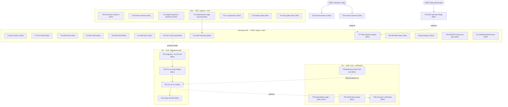

# Pareto Plan — Release Path First, Then the Full Backlog (2026-11-12)

> Sources: the REBUILT `TODO_LIST.md` (2026-11-11 audit: 11 open + 25 blocked rows),
> the 2026-11-11 status reports (16-43 audit + release-path items), the master plan
> (`2026-11-05_02-56_pareto-master-plan.md`, M12+ outstanding), and the inline
> health report of the docs-health audit session. Every task below was
> freshness-checked against CHANGELOG/code per pareto-planning Step 0 — errata in
> the table below. This plan does NOT replace the master plan; it SEQUENCES its
> outstanding M-rows together with everything newer, under one Pareto.

**Total: 31 comprehensive tasks ≈ 30.75 h (T-table) broken into 138 fine tasks ≤ 12 min
(F-table). The pareto-planning skill's 27-task / 150-task caps are intentionally
exceeded — the user's "It should include ALL TODOS" instruction wins (same ruling
as the 2026-11-05 master plan). Nothing was dropped or merged away.**

## Prior-plan dispositions & errata (Step 0 corrections)

| Item                                                    | Prior state                  | Correction (verified 2026-11-11/12)                                                              |
| ------------------------------------------------------- | ---------------------------- | ------------------------------------------------------------------------------------------------ |
| M31 (host-Chromium + chromedp v0.21 runtime proof)      | open 80%                     | ✅ RESOLVED — host healed 2026-11-06, 22/22 browser suite on Chromium 157, 2026-11-11 (annotated) |
| M32 (issue #17 nightly-fuzz triage)                     | open 80%                     | ✅ RESOLVED 2026-11-11 — run 38674181389 was a build failure, not a crasher; closed with evidence (annotated) |
| Master plan M01–M11                                     | open/in-progress             | ✅ ALL SHIPPED (v0.13.2 train, annotated with commit hashes 2026-11-11)                           |
| 16-43 report "ahead 5, unpushed"                        | blocking state               | STALE — master pushed & in sync with origin; #31/#23 closable post-release                        |
| TODO_LIST rows 60/61/62 (issue #23 disposition, NixOS bump, LSP repoint) | blocked     | RESOLVED — purged in the 2026-11-11 rebuild; dispositions live in CHANGELOG/AGENTS                |
| `docs/status/2026-10-25_13-38` report                    | "kept in place, open"        | ARCHIVED 2026-11-11 (all blockers landed; manifest corrected)                                     |
| ISSUE #32 "master CI is red"                             | not tracked anywhere         | NEW top-of-queue row (run 43061375783: race + browser jobs red; locally green at the same Go tree) |

## Pareto breakdown

| Tier  | Tasks                    | ≈ Effort | Cumulative result delivered                                                                                                                                                                                                                     |
| ----- | ------------------------ | -------- | ----------------------------------------------------------------------------------------------------------------------------------------------------------------------------------------------------------------------------------------------- |
| **1%**  | T01–T04 (4 of 31 tasks)  | ~4 h     | **51%** — master green again (#32 dead), v0.13.3 cut with the two consumer-facing fixes (#31 pill, #23 data-nonce) + the NixOS module, issues closed, consumers unblocked. Nothing else on this board matters if the release path stays red.       |
| **4%**  | T01–T08 (8 of 31 tasks)  | ~7.75 h  | **64%** — the release is TRUSTED, not just cut: pre-cut verification battery (coverage/vulncheck/fuzz/soak/browser), dependabot noise dead with a standing policy, the shipped-but-never-booted NixOS surface verified, consumers (cqrs-htmx + renamer + sibling sweep) proven. |
| **20%** | T01–T15 (15 of 31 tasks) | ~13.25 h | **80%** — truth hygiene everywhere: the unsourced Chromium claim killed, `docs/status/` rotated + manifest honest, the audit's process lessons written down, the watchdog watched-list single-sourced, CI ergonomics (job names, artifacts, loud browser-skip), docs-gates backlog draining again. |
| rest  | T16–T31 (16 of 31 tasks) | ~17.5 h  | **100%** — the master plan's observability/engine tasks (M13–M24), chaos-load validation, watchdog hardening, the two user-gated decision batches, upstream filings, fleet riders, go-etag port, AGENTS restructure prep, standing-blocked documentation. |

## Comprehensive plan — 31 tasks, 30–100 min each (ALL todos; sorted by tier, impact, effort, customer value)

| ID  | Tier | Task (covers)                                                                                                                                                            | Min | Impact | Effort | Customer value                                        |
| --- | ---- | ------------------------------------------------------------------------------------------------------------------------------------------------------------------------ | --- | ------ | ------ | ----------------------------------------------------- |
| T01 | 1%   | Diagnose + fix master CI red (#32): reproduce `TestShutdown_StopsPusherLoopGoroutine` (race job) + `TestBrowser_CollapseInteract` (browser job), classify flake-under-load vs real regression at the Go-identical `e3a0e9d..2ca9eca` tree, fix/harden, uncached failed-job rerun, green, close #32 | 90  | Critical | M    | Master is trustworthy again; the release path unblocks |
| T02 | 1%   | Pre-cut verification battery: coverage floor, vulncheck, hottest fuzz targets 60s each (nightly covers the rest), full-package race soak, browser suite green on Chromium 157 | 60  | Critical | M    | The cut is verified, not hoped                        |
| T03 | 1%   | Cut v0.13.3: re-head `[Unreleased]` (Fixed entries verbatim — 16-43 §f36 check) + `Version` bump + footer link in ONE change; gate 0 re-run AFTER the edits; tag first then master; `verify-release.sh`; publish draft; confirm Release integrity workflow | 60  | Critical | M    | Consumers get the pill + data-nonce fixes             |
| T04 | 1%   | Post-release closure: close #31 + #23 with v0.13.3 evidence comments; annotate the 16-43 report's §b release-path residuals (done at the cut)                                | 30  | Critical | S    | Issues dead, history honest                           |
| T05 | 4%   | Dependabot triage + standing policy: close the chromedp 0.21→0.22 branch with the policy comment; add ignore-rule/allowlist for chromedp minors to `.github/dependabot.yml` (API-migration ceremony linkage) | 45  | High   | S      | CI noise stops masking real failures                  |
| T06 | 4%   | Behavioral strict-CSP browser test for #23: strict CSP WITHOUT `unsafe-eval`, nonce wired, live region must CONNECT and patch (proves Datastar skips `new Function` via the root data-nonce); mutation-checked | 90  | High   | M      | The #23 fix is behaviorally pinned, not just structurally |
| T07 | 4%   | NixOS module boot smoke: boot `nixosModules.default` (container/VM harness), verify the systemd unit + loopback `/health` + remotes config; flip FEATURES → FULLY_FUNCTIONAL; cross-link deploy/README.md | 90  | High   | M      | The shipped module is verified, not assumed           |
| T08 | 4%   | Consumer verification: cqrs-htmx e2e pill battery (repo: cqrs-htmx); file-and-image-renamer nonce-boot-script retirement check (repo:); sibling pill-markup `git log -S` sweep | 60  | High   | M      | The #31 fix provably works where it was reported      |
| T09 | 20%  | Chromium `[hidden]` UA version-boundary research (Chromium source/PSA); sourced correction of the #31 comment + residual AGENTS wording                                        | 45  | Medium | S      | No unsourced claims in public issues                  |
| T10 | 20%  | Archive-rotation sweep: ANNOTATE→gate→archive candidates 14-19 / 11-19 / 11-34 / 15-17 / 15-45 + refresh the stale 14-19 "active handoff" manifest entry (its items shipped in v0.13.2) | 45  | Medium | M      | `docs/status/` stays scannable; manifest honest       |
| T11 | 20%  | Hygiene lessons write-down: rewrite-diff discipline, `grep -L` exit-semantics trap, `fresh:skip` pattern (docs-gates note) + daemon-commit disclosure mapping                    | 30  | Medium | S      | This audit's three process failures can't recur silently |
| T12 | 20%  | Watchdog watched-list single-sourcing: ONE source array, derived gate-11 + script + docs views, drift guard test (M30 groundwork)                                             | 45  | Medium | S      | A new workflow can't go silently unwatched            |
| T13 | 20%  | CI ergonomics: red-alert issue template names the failing job; Hygiene uploads the fmt-drift diff artifact; `.#test`/`.#build` print a loud browser-suite-skipped line (or formally park) | 30  | Medium | S      | Faster diagnosis; greens become interpretable         |
| T14 | 20%  | Test-helper polish: computed-style visibility assertion into the shared browser helper; templ LSP restart; chromedp-helper-typing note confirmed into ROADMAP                     | 30  | Low    | S      | Future show/hide UI provable; phantom squiggles gone  |
| T15 | 20%  | docs-gates audit-all drain session: annotate the biggest stale cluster of the 86 with evidence, lower the `audit_max` pin, sync TODO/CHANGELOG text                              | 45  | Medium | S      | The ratchet moves the right way                       |
| T16 | rest | M13: SSE connection counters (`opened/closed/active`) + watchdog gauge in the metrics exposition (tests + docs/metrics.md)                                                     | 45  | High   | M      | Operators see live/leak state in monitoring           |
| T17 | rest | M14+M15: rate-limit observability metrics (429 counter, Retry-After histogram) + connection-lifetime jitter + Retry-After on connection-limit 503s                              | 60  | Medium | M      | 429s and reconnect herds visible/prevented            |
| T18 | rest | M20+M24: devShell shellcheck + actionlint; cold-cache `check-ui-pins.sh` behavior test                                                                                         | 45  | Medium | S      | Script bugs die locally; pin drift caught cold        |
| T19 | rest | M21+M22+M23: markdown-lint pass over docs/; interrogate doc-coverage baseline; buildflow rerun-failed-uncached baseline evidence                                                 | 60  | Low    | M      | Docs render clean; comment debt measured              |
| T20 | rest | M18+M19: compose build-only CI job (decision-safe slice of the compose policy) + hub boot-smoke CI design; cross-process browser file-lock                                         | 60  | Medium | M      | Federation + browser rig regressions caught early     |
| T21 | rest | M16+M17: per-IP rate limits (opt-in) + request-logging middleware (opt-in, slog)                                                                                                 | 45  | Medium | M      | Multi-tenant safety; debuggability without log-by-default |
| T22 | rest | M12: chaos-load validation — stress-ng under the full-package race suite; evidence vs the documented flake classes (feeds T01's verdict too)                                      | 90  | Medium | L      | Confidence the margin fixes survive CI load           |
| T23 | rest | M30: watchdog hardening — `workflow_run`/fork security audit, self-watch check, watched-list dedupe (rides T12's single source)                                                  | 60  | Medium | M      | The pager can't have its own blind spot               |
| T24 | rest | DECISION BATCH A (user-gated, M26+): release cadence for chore-only deltas; em-dash copy for shipped strings; GOEXPERIMENT=jsonv2 posture; compose-stack CI policy; tag-ruleset bypass; second-session-during-release policy — present options + recommendations, park for user | 45  | High   | S      | Six blocked rows unblock                              |
| T25 | rest | DECISION BATCH B (user-gated, M27+): evidence machine contract; build-tag SSE gating; fleet CI-lint/filing policy; PVR enablement; issue #14 contract wording; pin-guard keep sign-off; MVS drift-watch policy; AGENTS.md size — present options + recommendations | 45  | High   | S      | Eight blocked rows unblock                            |
| T26 | rest | M25: upstream filings batch — re-verify the three drafts TODAY (templ gofumpt output, erraudit nolint-audit, StatCard green-tone contrast) per verify-before-filing, then file the authorized ones | 60  | Medium | M      | Fixes land upstream; local patches shrink             |
| T27 | rest | M28: ListNote adoption for the timeline cap (check templ-components#37 state first) + copy-affordance re-evaluation (script-emitting clash still true?)                          | 45  | Low    | M      | UI polish with library support                        |
| T28 | rest | M29 fleet riders: CV bump prep notes; dnsblockd lockstep gate re-check (go-datastar static tag ls-remote); MVS fleet-watch polish                                                 | 45  | Medium | S      | Consumers ride the latest release                     |
| T29 | rest | go-etag fragile-grep port (repo: go-etag): apply the proven release-cut/release-assess grep-chain fix pattern to `scripts/pre-release-check.sh`                                    | 30  | Low    | S      | A sibling release flow stops swallowing failures      |
| T30 | rest | AGENTS.md restructure PREP (decision rides T25): map what moves to `docs/` (dependency-note long-form, gotcha detail) vs stays; produce the target outline                          | 30  | Low    | S      | The 537-vs-220 question becomes a one-approval change |
| T31 | rest | Standing-blocked documentation pass: re-check BuildFlow pins for the go-structure-linter/templ-generate unskip conditions; relabel-daemon standing-pattern note; compose boot-verify dependency note (needs container runtime) | 30  | Low    | S      | Blocked rows carry current unblock conditions         |

## Fine plan — 138 subtasks, ≤ 12 min each (ALL todos; same sort order)

| ID   | Task                                                                                                            | Min | Parent |
| ---- | --------------------------------------------------------------------------------------------------------------- | --- | ------ |
| F01  | Reproduce `TestShutdown_StopsPusherLoopGoroutine` under `-race -count=3` full-package noise                       | 12  | T01    |
| F02  | Reproduce `TestBrowser_CollapseInteract` on Chromium 157 (devShell, serialized)                                    | 12  | T01    |
| F03  | Read CI logs of runs 43060709205 + 43061375783 failed jobs in full (env diff: shuffle, load, Chrome version)         | 12  | T01    |
| F04  | Classify: flake-under-CI-load vs real regression from `e3a0e9d`'s markup/status.go changes                        | 12  | T01    |
| F05  | Implement the fix (real fix or margin hardening per the wall-clock doctrine)                                       | 12  | T01    |
| F06  | Mutation-check: the fix/hardening discriminates (sed+restore, `git log -S` closer per the new gotcha)               | 12  | T01    |
| F07  | Local gates: full unit suite + `nix run .#lint` + `.#vet`                                                          | 12  | T01    |
| F08  | Push the fix; rerun the failed jobs UNCRYPTED; watch green; close #32                                              | 12  | T01    |
| F09  | `nix run .#coverage` — floor check on the release candidate                                                        | 12  | T02    |
| F10  | `nix run .#vulncheck`                                                                                              | 12  | T02    |
| F11  | Fuzz campaigns batch 1 (4 hottest targets, 60s each)                                                               | 12  | T02    |
| F12  | Fuzz campaigns batch 2 (next 4 targets)                                                                            | 12  | T02    |
| F13  | Fuzz campaigns batch 3 (next 4; nightly covers the remainder)                                                      | 12  | T02    |
| F14  | Race soak: full package `-race -count=3`                                                                           | 12  | T02    |
| F15  | Browser suite green on Chromium 157 + goldens-fresh check                                                          | 12  | T02    |
| F16  | Re-head `[Unreleased]` → `0.13.3` + `Version` const bump + footer link (one change)                                | 12  | T03    |
| F17  | Verify the three `[Unreleased]` Fixed entries survived the re-head VERBATIM (16-43 §f36)                           | 12  | T03    |
| F18  | Gate 0 re-run AFTER the release edits (changelog lint + templ stamps)                                              | 12  | T03    |
| F19  | `nix fmt` + final tree check; intent commit                                                                        | 12  | T03    |
| F20  | Tag v0.13.3; push TAG first, then master                                                                           | 12  | T03    |
| F21  | `verify-release.sh 0.13.3` — 9/9                                                                                   | 12  | T03    |
| F22  | Publish draft (`gh release edit --draft=false`) after CI green; confirm the Release integrity workflow produced it  | 12  | T03    |
| F23  | Close #31 with the v0.13.3 evidence comment                                                                        | 12  | T04    |
| F24  | Close #23 with the v0.13.3 evidence comment                                                                        | 12  | T04    |
| F25  | Annotate the 16-43 report's §b release-path residuals (`done at` the cut)                                          | 6   | T04    |
| F26  | Close dependabot branch `minor-and-patch-bca993d97f` with the policy comment                                        | 12  | T05    |
| F27  | Draft `.github/dependabot.yml` ignore-rule/allowlist for chromedp minors                                           | 12  | T05    |
| F28  | Document the chromedp-bump ceremony linkage (AGENTS one-liner)                                                     | 12  | T05    |
| F29  | Validate dependabot.yml (actionlint/yamllint)                                                                      | 9   | T05    |
| F30  | Design the behavioral test: strict-CSP header (no `unsafe-eval`) + WithNonce + root data-nonce precondition         | 12  | T06    |
| F31  | Write `TestBrowser_StrictCSPNoEvalConnects` (session, live-region connect wait)                                    | 12  | T06    |
| F32  | Assert the SDK actually PATCHED the DOM (behavioral proof, not just connection)                                    | 12  | T06    |
| F33  | Run on Chromium 157; zero console errors under the strict policy                                                   | 12  | T06    |
| F34  | Mutation-check: remove the root data-nonce stamp → test fails loudly                                               | 12  | T06    |
| F35  | Goldens/CSP-clean assertions green; lint + vet                                                                     | 12  | T06    |
| F36  | Probe available boot harnesses (nixos-container / QEMU VM) on this host                                             | 12  | T07    |
| F37  | Build the minimal test VM/container config importing `nixosModules.default`                                         | 12  | T07    |
| F38  | Boot + wait for the systemd unit active                                                                            | 12  | T07    |
| F39  | Probe `/health` + `/healthz` on loopback (200 + HTML)                                                              | 12  | T07    |
| F40  | Verify `remotes` option flows to `HEALTH_HUB_REMOTES` behavior (dark-remote fail row)                               | 12  | T07    |
| F41  | Flip the FEATURES NixOS row → FULLY_FUNCTIONAL; cross-link deploy/README.md                                         | 12  | T07    |
| F42  | Record boot evidence (TODO row disposition + report line)                                                           | 12  | T07    |
| F43  | Run cqrs-htmx's e2e pill battery in its repo (repo: cqrs-htmx)                                                      | 12  | T08    |
| F44  | file-and-image-renamer: assess nonce boot-script retirement against v0.13.3 (repo:)                                 | 12  | T08    |
| F45  | List consumer repos (the MVS hazard list) + locate the pill markup pattern                                          | 12  | T08    |
| F46  | `git log -S` sweep across consumers for the old attribute-hidden markup                                             | 12  | T08    |
| F47  | Record sweep dispositions on the repo:-tagged TODO rows                                                             | 12  | T08    |
| F48  | Search Chromium source/PSA for the `[hidden]` UA-handling change boundary                                           | 12  | T09    |
| F49  | Version matrix: old markup on 156 vs 157 (local if possible, else cite sources)                                     | 12  | T09    |
| F50  | Draft the sourced correction comment for #31                                                                        | 12  | T09    |
| F51  | Post the correction; align residual AGENTS wording                                                                  | 9   | T09    |
| F52  | Triage the five archive candidates' §f item states (14-19, 11-19, 11-34, 15-17, 15-45)                              | 12  | T10    |
| F53  | Annotate + gate 14-19; refresh its stale "active handoff" manifest entry                                            | 12  | T10    |
| F54  | Annotate + gate two more candidates                                                                                 | 12  | T10    |
| F55  | Annotate + gate the last two; `git mv` all; update the manifest                                                     | 9   | T10    |
| F56  | Write the rewrite-diff + `grep -L` lessons into docs/gotchas.md                                                     | 12  | T11    |
| F57  | Write the `fresh:skip` token-poor-item pattern note (docs-gates usage)                                              | 12  | T11    |
| F58  | Draft the daemon-commit disclosure mapping for the next intent commit                                               | 6   | T11    |
| F59  | Design the watched-workflows single source (script array as truth; derive gate-11 + docs)                           | 12  | T12    |
| F60  | Implement the derivation/shared file                                                                                | 12  | T12    |
| F61  | Drift guard test (a new workflow in one copy fails loudly)                                                          | 12  | T12    |
| F62  | Wire all three consumers; run the gates                                                                             | 9   | T12    |
| F63  | Red-alert issue template: include the failing job name                                                              | 12  | T13    |
| F64  | Hygiene job: upload the fmt-drift diff as an artifact                                                               | 9   | T13    |
| F65  | `.#test`/`.#build`: loud "browser suite skipped/ran" line (implement or formally park)                              | 9   | T13    |
| F66  | Extract the computed-style visibility assertion into the shared browser helper                                       | 12  | T14    |
| F67  | Refactor `TestBrowser_ConnectionPill` onto the helper                                                               | 9   | T14    |
| F68  | Restart the templ LSP; confirm the phantom diagnostics cleared                                                      | 9   | T14    |
| F69  | Pick the biggest stale cluster from the audit-all replay                                                            | 12  | T15    |
| F70  | Annotate the cluster with evidence verdicts (annotate.go)                                                           | 12  | T15    |
| F71  | Lower `audit_max` by the drained count; sync TODO/CHANGELOG text                                                    | 12  | T15    |
| F72  | Battery green; commit the drain                                                                                     | 9   | T15    |
| F73  | Design SSE counters (`opened/closed/active`) + watchdog gauge exposition (M13)                                      | 12  | T16    |
| F74  | Implement in metrics.go + pusher hooks                                                                              | 12  | T16    |
| F75  | Tests: deterministic sorted output, label escaping                                                                  | 12  | T16    |
| F76  | docs/metrics.md + README metrics block                                                                              | 9   | T16    |
| F77  | Design the 429 counter + Retry-After histogram (M14)                                                                | 12  | T17    |
| F78  | Implement ratelimit metrics                                                                                         | 12  | T17    |
| F79  | Jitter on `WithMaxConnectionLifetime` (M15)                                                                         | 12  | T17    |
| F80  | Retry-After on connection-limit 503s (`atCapacity`)                                                                 | 12  | T17    |
| F81  | Tests for both                                                                                                      | 12  | T17    |
| F82  | devShell: shellcheck + actionlint wiring (M20)                                                                      | 12  | T18    |
| F83  | Run over scripts/; fix findings                                                                                     | 12  | T18    |
| F84  | Cold-cache pins-guard test (M24): design + implement                                                                | 12  | T18    |
| F85  | Pre-push/CI wiring for the new checks                                                                               | 9   | T18    |
| F86  | markdown-lint: toolchain + config (M21)                                                                             | 12  | T19    |
| F87  | Pass over docs/; fix findings                                                                                       | 12  | T19    |
| F88  | interrogate: baseline run + threshold decision (M22)                                                                | 12  | T19    |
| F89  | buildflow rerun-failed-uncached baseline evidence (M23)                                                             | 12  | T19    |
| F90  | Docs + ROADMAP row updates for the three                                                                            | 12  | T19    |
| F91  | CI: compose build-only job (decision-safe slice of M18)                                                             | 12  | T20    |
| F92  | Hub boot-smoke CI design (runtime-scoped: build + config test)                                                      | 12  | T20    |
| F93  | Cross-process browser file-lock design (M19)                                                                        | 12  | T20    |
| F94  | Implement the flock in `browserSerial` helpers                                                                      | 12  | T20    |
| F95  | Two-process contention test locally                                                                                 | 12  | T20    |
| F96  | `WithPerIPRateLimit` design (M16, opt-in)                                                                           | 12  | T21    |
| F97  | Implement + tests                                                                                                   | 12  | T21    |
| F98  | `WithRequestLogging` (slog, opt-in) design + implement (M17)                                                        | 12  | T21    |
| F99  | Tests + docs + README options block                                                                                 | 9   | T21    |
| F100 | Probe/install stress-ng (M12)                                                                                       | 12  | T22    |
| F101 | CPU-stress run 1: full-package `-race -count=2` under load                                                          | 12  | T22    |
| F102 | CPU-stress run 2: rate-limit + watchdog margins under load                                                          | 12  | T22    |
| F103 | CPU-stress run 3: serialized browser suite under load                                                               | 12  | T22    |
| F104 | Evidence to docs/research/benchmarks; verdict vs the flake classes (feeds T01)                                      | 12  | T22    |
| F105 | `workflow_run`/fork security audit of master-red-alert (M30)                                                        | 12  | T23    |
| F106 | Self-watch check: does the watchdog see its own workflow red?                                                       | 12  | T23    |
| F107 | Watched-list dedupe via T12's single source                                                                         | 12  | T23    |
| F108 | Fixes + tests                                                                                                       | 12  | T23    |
| F109 | Docs for the hardening                                                                                              | 12  | T23    |
| F110 | Decision batch A: draft the six-decision presentation doc                                                           | 12  | T24    |
| F111 | Per-decision options + recommendation + blast radius                                                                | 12  | T24    |
| F112 | File (issue or docs/decisions draft); link from the Blocked rows                                                    | 12  | T24    |
| F113 | Park for user; mark the rows awaiting-decision                                                                      | 9   | T24    |
| F114 | Decision batch B: draft the eight-decision presentation doc                                                         | 12  | T25    |
| F115 | Options + recommendations                                                                                          | 12  | T25    |
| F116 | File + link; park for user                                                                                          | 12  | T25    |
| F117 | Re-verify the templ gofumpt draft against CURRENT templ (verify-before-filing)                                      | 12  | T26    |
| F118 | Re-verify the erraudit nolint-audit draft                                                                           | 12  | T26    |
| F119 | Re-verify the StatCard contrast draft (`TestRender_ContrastSafeStatusColors`)                                       | 12  | T26    |
| F120 | File the authorized ones; record links/hashes                                                                       | 12  | T26    |
| F121 | Update the Blocked rows with filing state                                                                           | 12  | T26    |
| F122 | Check templ-components#37 state (ListNote custom-message hook shipped?)                                             | 12  | T27    |
| F123 | If shipped: adopt ListNote for the timeline cap + goldens                                                           | 12  | T27    |
| F124 | Copy affordance re-eval (script-emitting clash still true?)                                                         | 12  | T27    |
| F125 | Dispositions + docs                                                                                                 | 9   | T27    |
| F126 | CV: draft bump-PR scope (deploy call stays user's — prep only)                                                      | 12  | T28    |
| F127 | dnsblockd: re-check the go-datastar static tag state (ls-remote)                                                    | 12  | T28    |
| F128 | MVS fleet-watch polish (tc doctor in consumer CI sketch)                                                            | 12  | T28    |
| F129 | Dispositions                                                                                                        | 9   | T28    |
| F130 | go-etag: fetch; locate the `\|\| true` grep chains (repo: go-etag)                                                  | 12  | T29    |
| F131 | Apply the proven grep-chain fix pattern                                                                             | 12  | T29    |
| F132 | Run its gates; open the PR                                                                                          | 6   | T29    |
| F133 | AGENTS restructure map: what moves to docs/ vs stays                                                                | 12  | T30    |
| F134 | Target outline into docs/decisions (or plan appendix)                                                               | 12  | T30    |
| F135 | Park for user sign-off (rides decision batch B)                                                                     | 6   | T30    |
| F136 | Re-check BuildFlow pins for the go-structure-linter/templ-generate unskip conditions                                | 12  | T31    |
| F137 | Relabel-daemon standing-pattern note (force-push banned; disclosure pattern)                                        | 12  | T31    |
| F138 | Compose boot-verify dependency note (needs the container-runtime decision)                                          | 6   | T31    |

## Coverage map — every open TODO row lands in a task

| Source row                                    | Task(s)        |
| --------------------------------------------- | -------------- |
| Fix master CI red (#32)                       | T01            |
| Cut v0.13.3                                   | T02 → T03      |
| Master plan M01–M32 umbrella                  | T16–T23 (+errata: M31/M32 resolved) |
| Watchdog watched-list single-sourcing         | T12 (+T23)     |
| docs-gates 86-item drain                      | T15            |
| go-etag fragile-grep port                     | T29            |
| Behavioral strict-CSP test (#23)              | T06            |
| cqrs-htmx e2e pill battery                    | T08            |
| Dependabot chromedp branch                    | T05            |
| NixOS boot smoke + deploy cross-link          | T07            |
| Chromium `[hidden]` research                  | T09            |
| Close #31/#23                                 | T04            |
| AGENTS.md size decision                       | T25 + T30      |
| Upstream drafts (templ/erraudit/StatCard)     | T26            |
| ListNote / copy affordance                    | T27            |
| CV / dnsblockd / MVS watch                    | T28 (+T25)     |
| Em-dash / release cadence / compose CI / tag-bypass / second-session | T24 |
| Build-tag SSE / fleet CI-lint / evidence contract / PVR / #14 contract / pin-guard sign-off | T25 |
| go-structure-linter / templ-generate unskips / relabel-daemon / deploy boot-verify | T31 (+T07, T24) |
| 16-43 §f residuals (coverage/vulncheck/fuzz/soak/browser, LSP restart, sibling sweep, computed-style helper, loud line, red-alert template, fmt-drift artifact, renamer nonce, carry-through, integrity workflow, 14-19 manifest) | T02, T03, T04, T08, T10, T13, T14 |

## Execution graph

## Execution notes (Verschlimmbesserung guards)

- The release path (T01→T04) is strictly ordered; everything in the 4% tier runs AFTER T01 in parallel with T02/T03. The 20%/rest tiers are independent of the release unless marked.
- T02's fuzz scope is honest: 12 of 13 targets get local 60s campaigns across three 12-min batches; nightly covers the remainder — do not silently claim "all 13 fuzzed locally".
- Docs-only sessions still obey the gates: `check-changelog.sh` at commit time, `nix fmt` before walking away, `git log -S` closer on any mutation check, and NEVER touch `go.mod`/`go.sum`/`*_templ.go` without `SWEEP_OK=1`.
- The daemon will interleave commits; verify each capture with `git show` (member (1) of the recovery recipe) and disclose the mapping at the next intent commit.
- The user-gated batches (T24/T25/T26) are PRESENTATION tasks: their deliverable is a decision document, not a decision — nothing unblocks without the user.
